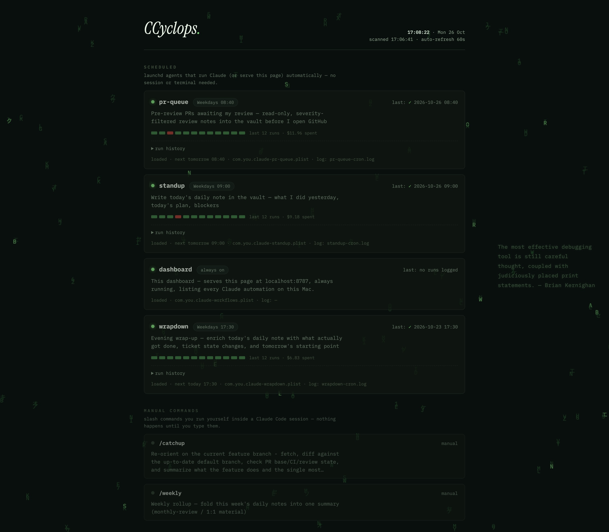
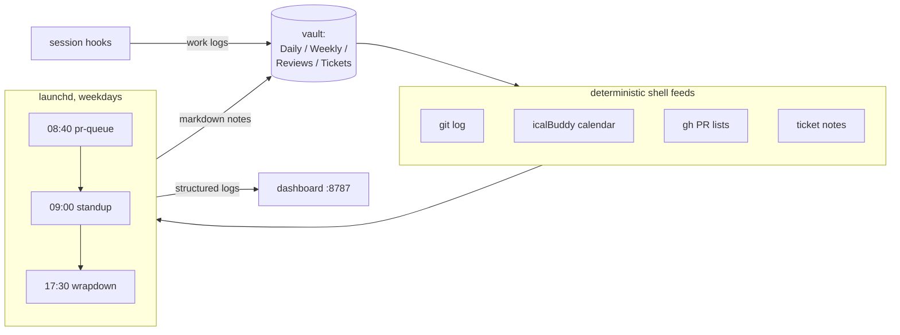

<div align="center">


# Claude Workflows

**A local AI chief-of-staff for your dev day — scheduled Claude Code agents that write your standup, pre-review your PRs, and wrap up your evening, all tracked on a matrix-rain dashboard.**




</div>

---

## What you get

Three scheduled agents, one always-on dashboard, and session hooks that make each other smarter — a pipeline where every piece feeds the next. Every time and every piece is a line in [`config.sh`](#configure--one-file):

| ⏰ default | Job | What it does |
|---|---|---|
| 08:40 | **pr-queue** | Pre-reviews every PR awaiting your review. Reads the diff, cross-checks callers in your local repos, writes a severity-filtered note per PR (Critical/High/Medium only — zero nitpicks). Its allowlist has no GitHub write commands and no git, and it can only write inside your vault. |
| 09:00 | **standup** | Writes today's daily note: what you did yesterday (from commits, ticket logs, calendar), today's plan, blockers — plus a copy-paste-ready standup block for your team, wikilinked to the fresh pre-review notes. |
| 17:30 | **wrapdown** | Appends an evening Wrap-up: what actually got done, what *didn't* happen vs. the morning plan, and tomorrow's starting point. Updates ticket statuses as PRs move. |
| always | **workflows** | A live dashboard at `localhost:8787` — every automation, schedule, run history, per-run cost, failures — wrapped in a matrix-rain background that decodes your favorite quotes. Ships as a Dock/Spotlight app. |

Plus two manual slash commands — **/weekly** (fold the week's daily notes into one summary) and **/catchup** (re-orient on the current feature branch) — and **session hooks**: every Claude Code session on a ticket branch starts knowing the ticket's history (SessionStart injects the ticket note) and ends by appending a work-log entry (SessionEnd) — which is exactly what tomorrow's standup reads. The loop closes itself.



## Requirements

| Dependency | Why | Install |
|---|---|---|
| macOS | `launchd` scheduling, notifications | — |
| [Claude Code](https://claude.com/claude-code) | the agent (`claude -p` headless) | the native installer or `npm i -g @anthropic-ai/claude-code`, then log in once |
| [gh](https://cli.github.com) | PR/issue feeds | `brew install gh && gh auth login` |
| `jq` | JSON parsing in the runner & hooks | `brew install jq` |
| Python ≥ 3.10 | the installer helper and the dashboard (stdlib only, zero pip installs) | `brew install python3` |
| [icalBuddy](https://hasseg.org/icalBuddy/) *(optional)* | meeting feeds — or set `CALENDAR=false` | `brew install ical-buddy` |
| Google Chrome *(optional)* | the chromeless app window | falls back to your default browser |

Cost: each job is one headless Claude session with a `--max-turns` cap. Typical day: standup ~$0.80, wrapdown ~$0.60, pr-queue ~$1–4 depending on how many PRs are new (unchanged PRs are skipped). On a Claude subscription these draw from your usage window instead of billing per token.

## Install

```bash
git clone https://github.com/AdisBacic/CCyclops.git
cd CCyclops
./install.sh    # asks a few questions, writes config.sh, installs everything
```

The installer copies everything into `~/.claude/`, registers the session hooks in `settings.json` (merging, never clobbering), builds the app bundle, and loads the launchd agents.

> **The lazy path:** clone the repo and tell Claude Code *"read this repo and set it up for me"*. The prompts, scripts, and this README are all the context it needs — it can also adapt any part to your workflow while it's at it (different times, another ticket system, no calendar…).

Then:

```bash
workflows                                    # opens the dashboard app window
bash ~/.claude/scripts/run-job.sh standup    # test-drive a job right now
```

## Configure — one file

Everything you'd want to change is in **`config.sh`** — created on the first run from [`config.example.sh`](config.example.sh), which documents every value. Edit it, then run `./install.sh` again. Re-running is always safe and only touches what changed; `./install.sh --dry-run` shows what that would be.

```bash
# Jobs: a schedule, "manual" (slash command only) or "off" (not installed)
JOB_PR_QUEUE="weekdays 08:40"
JOB_STANDUP="weekdays 09:00"
JOB_WRAPDOWN="weekdays 17:30"
JOB_WEEKLY="manual"

# Features
DASHBOARD=true
CALENDAR=true
HOOK_TICKET_LOG=true
```

| Want to… | In `config.sh` |
|---|---|
| move a job | `JOB_STANDUP="weekdays 08:45"` — also `daily 07:30`, `mon,wed,fri 16:00`, `weekdays 09:00 13:00`, `every 2h` |
| run a job only by hand | `JOB_WRAPDOWN="manual"` |
| drop a command entirely | `JOB_CATCHUP="off"` |
| no dashboard / no calendar | `DASHBOARD=false` · `CALENDAR=false` |
| stop a session hook | `HOOK_TICKET_LOG=false` |
| notes in another language | `LANGUAGE="Svenska"` |
| Jira-style ticket keys | `TICKET_PATTERN="[A-Z]+-[0-9]+"` |
| other dev-server ports to warn about | `DEV_SERVER_PORTS="3000 5173"` |

Typos don't slip through: the installer checks the file before changing anything — an unknown day, a `true`/`false` that's neither, or a `JOB_STANDUPP` that matches no command is reported, and nothing is installed until it's fixed. `./install.sh --reconfigure` asks the setup questions again; `CCYCLOPS_CONFIG=~/dotfiles/ccyclops.sh ./install.sh` keeps the config somewhere else.

## Add your own job

A job is one Markdown file plus one config line. Drop a command into `commands/`:

```markdown
---
description: Draft release notes from this week's merged PRs
allowed-tools: Bash(gh pr list:*), Read, Write, Glob
max-turns: 30
preflight: gh-auth
---

Recently merged:
!`gh pr list -R {{MAIN_REPO}} --state merged --limit 30 --json number,title,mergedAt`

Write release notes for the PRs merged in the last 7 days to `{{VAULT}}/Workflows/Releases/<today>.md` …
```

(Injected `` !`…` `` lines can't use `$`-expansions — put anything fancier in a script, like `scripts/weekly-prs.sh`.)

…add `JOB_RELEASE_NOTES="fri 15:00"` to `config.sh`, and run `./install.sh`. It becomes `/release-notes`, a launchd agent, and a card on the dashboard (described by its own frontmatter).

| Frontmatter | Meaning |
|---|---|
| `allowed-tools` | what the job may run — the same list the manual `/command` uses |
| `max-turns` | turn cap (default `MAX_TURNS`) |
| `preflight` | checks before Claude starts: `gh-auth`, `calendar-cache` |
| `add-dirs` | extra folders Claude may read: `projects` |

Any `{{KEY}}` in a command is filled from `config.sh` — including keys you add yourself (`TEAM="Platform"` → `{{TEAM}}`). A new session hook works the same way: drop `hooks/<name>.sh` whose second line reads `# SessionEnd hook: …` (or `SessionStart`, …) and switch it with `HOOK_<NAME>`.

## Obsidian — or any folder of Markdown

Everything the agents write is **plain Markdown in plain folders**:

```
<your vault>/Workflows/
├── Daily/      2026-09-01.md …      ← standup + wrapdown
├── Weekly/     2026-W36.md …        ← /weekly rollup
├── Reviews/    repo-PR123.md …      ← pr-queue
└── Tickets/    1234 Fix login.md …  ← session hooks
```

**With Obsidian**: point a vault at (or above) this folder and you get wikilinks between dailies ↔ tickets ↔ reviews, graph view, and a one-click copy button on the standup block for free.

**Without Obsidian**: it all still works — any editor, `grep`, GitHub, Logseq, or nothing at all. Only two conveniences are Obsidian-flavored: `[[wikilinks]]` and the copy button on code fences. To go fully tool-neutral, edit `commands/standup.md` and `commands/wrapdown.md` and change the wikilink rules to plain text. Different destination entirely (a git repo of notes, iCloud, a synced folder)? Just set `VAULT` to it.

## Make it yours

| What | How |
|---|---|
| **Prompts** (standup voice & format, review rules…) | edit `commands/*.md` in the repo, then `./install.sh` — not the copies in `~/.claude/commands`, the installer replaces those |
| **Quotes in the rain** | `~/.claude/scripts/workflows-quotes.json` — `{"quotes": ["…", "…"]}`, picked up on next refresh, never overwritten by the installer |
| **Dashboard palette** | CSS variables at the top of `scripts/workflows-dashboard.py` (`--bg`, `--ok`, `--err`, …) |
| **Rain speed / glyphs / fps** | constants at the top of the `JS` block in the same file (`GLYPHS`, `speeds`, the fps cap) |
| **Page favicon** | replace `~/.claude/scripts/workflows-favicon.png` |
| **App icon** | run `tools/mask_icon.py` on any square PNG to get macOS-style rounded icons, or `tools/make_icon.py` for the generated default; compile with `iconutil` |

## Design principles

These are the load-bearing decisions — keep them when you fork:

1. **Deterministic work in shell, Claude only synthesizes.** Git, calendar, and PR data are gathered by scripts and injected as context. Cheap, reproducible, debuggable.
2. **Scoped permissions.** Every job runs with `--permission-mode acceptEdits`, its command's own `allowed-tools` list, and deny rules that block edits outside the vault — `~/.claude` and your repos are read-only to jobs. The PR reviewer's allowlist simply contains no GitHub write commands and no git.
3. **Fail loud, never thinner.** If a data feed errors, the job refuses to write and notifies you (`FEED FAILURE`), instead of producing a note that looks fine but is silently missing data.
4. **Control flow lives in bash, not the model.** Watchdog, one retry, JSON parsing, cost logging, usage-limit detection, and macOS notifications are all in `scripts/run-job.sh` — the LLM is treated like an API dependency.

## Uninstall

```bash
./install.sh --uninstall
```

Removes the launchd agents, app, commands, hooks (unregistered from `settings.json`, leaving your other hooks alone) and scripts. Left in place on purpose: your notes in `<vault>/Workflows/`, your quotes and favicon, the run logs (`~/.claude/logs/*-cron.log`, `*-launchd.log`), and the calendar cache. Delete them by hand for a clean slate. If you added the Dock icon, drag it out of the Dock.

## Troubleshooting

<details>
<summary><b>A job failed — where do I look?</b></summary>

The dashboard shows a red banner for failures in the last 7 days (dismissable with ×), and you get a macOS notification. Details: `tail -50 ~/.claude/logs/<job>-cron.log`, or re-run it and watch: `bash ~/.claude/scripts/run-job.sh <job>`. Exit codes: `1` claude error · `2` feed failure · `3` pre-flight failed (usually `gh auth login` needed, or `MAIN_REPO_DIR` doesn't exist) · `124` watchdog kill.
</details>

<details>
<summary><b>The meetings section is empty</b></summary>

icalBuddy needs the Calendar permission: run `icalBuddy eventsToday` once in Terminal and approve the macOS prompt. Headless Claude can't hold that grant, which is why the runner pre-fetches to a cache before launching Claude. No calendar at all? Set `CALENDAR=false`.
</details>

<details>
<summary><b>Runs fail around heavy-usage times</b></summary>

On a Claude subscription, the rolling usage window can starve scheduled jobs. The runner detects it, notifies you, and skips the pointless retry. Move heavy jobs away from your peak interactive hours in `config.sh` if it recurs.
</details>

<details>
<summary><b>Jobs don't run when the Mac is asleep</b></summary>

`launchd` fires a missed `StartCalendarInterval` once on wake (not if powered off). If your Mac sleeps through 09:00, the standup runs when you open the lid.
</details>

## Development

`bash tests/smoke.sh` installs into a throwaway `$HOME` with fake `claude`/`gh`/`launchctl`, runs jobs and hooks, flips settings, and uninstalls — 60-odd checks, nothing touches your real setup. CI runs it on macOS, plus shellcheck.

## License

MIT — fork it, gut it, make it write your standup.
