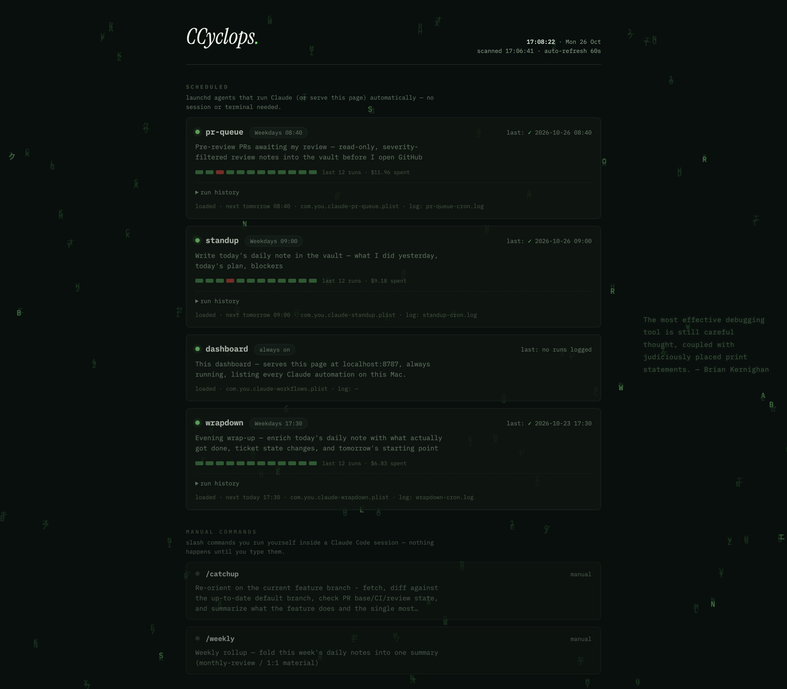
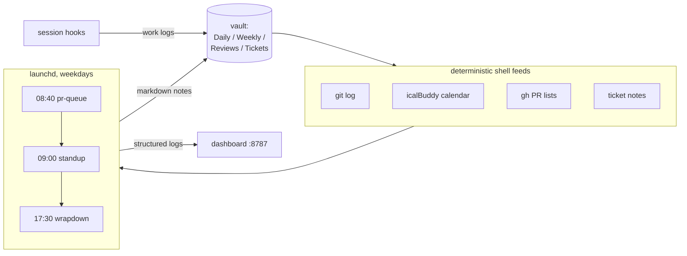

<div align="center">


# CCyclops

**A local AI chief-of-staff for your dev day — scheduled Claude Code agents that write your standup, pre-review your PRs, and wrap up your evening, all tracked on a matrix-rain dashboard.**

[](https://github.com/AdisBacic/CCyclops/actions/workflows/ci.yml)




</div>

---

## What you get

Three scheduled agents, one always-on dashboard, and session hooks that make each other smarter — a pipeline where every piece feeds the next. Every time and every piece is a line in [`config.sh`](#configure--one-file):

| ⏰ default | Job | What it does |
|---|---|---|
| 08:40 | **pr-queue** | Pre-reviews every PR awaiting your review. Reads the diff, cross-checks callers in your local repos, writes a severity-filtered note per PR (Critical/High/Medium only — zero nitpicks). Its allowlist has no GitHub write commands and no git, and it can only write inside your vault. |
| 09:00 | **standup** | Writes today's daily note: what you did yesterday (from commits, ticket logs, calendar), today's plan, blockers — plus a copy-paste-ready standup block for your team, wikilinked to the fresh pre-review notes. |
| 17:30 | **wrapdown** | Appends an evening Wrap-up: what actually got done, what *didn't* happen vs. the morning plan, and tomorrow's starting point. Updates ticket statuses as PRs move. |
| always | **dashboard** | A live dashboard at `localhost:8787` — every automation, schedule, run history, per-run cost, failures — wrapped in a matrix-rain background that decodes your favorite quotes. Ships as a Dock/Spotlight app. |

Plus two manual slash commands — **/weekly** (fold the week's daily notes into one summary) and **/catchup** (re-orient on the current feature branch) — and **session hooks**: every Claude Code session on a ticket branch starts knowing the ticket's history (SessionStart injects the ticket note) and ends by appending a work-log entry (SessionEnd) — which is exactly what tomorrow's standup reads. The loop closes itself.



## Set it up with Claude

About 10 minutes. Each step is a prompt you paste into Claude Code — use the copy button on the block. Claude reads the repo, asks what it needs to know, and does the work. Prefer doing it by hand? Skip to [Install](#install).

**1. Get the code and start Claude in it** (fork first if you plan to change the prompts)

```bash
git clone https://github.com/AdisBacic/CCyclops.git
cd CCyclops
claude
```

**2. Check that your Mac has what it needs**

```text
Read README.md and install.sh. Check which requirements are already on this Mac
(Claude Code, gh, jq, Python 3.10+, icalBuddy, Chrome) and install the missing ones
with Homebrew. Then check that gh is logged in. Finish with a list of anything I
have to do myself, with the exact command for each. Don't run install.sh yet.
```

**3. Configure it for you**

```text
Set up CCyclops for me. Run ./install.sh once so it creates config.sh, then read
config.example.sh and ask me, one question at a time: where my notes folder is,
which folder holds my git clones, where my PRs live on GitHub (org or repos),
which calendars to read (or none), what language the notes should be in, and
what time I start and end my day. Write my answers into config.sh and set the
three job times to fit my day. Run ./install.sh --dry-run and show me what it
will change. Wait for my OK before you run ./install.sh for real.
```

**4. Try it**

```text
Run the standup job now: bash ~/.claude/scripts/run-job.sh standup
Show me the note it wrote and what the run cost. If it failed, read
~/.claude/logs/standup-cron.log, tell me the cause and fix it. Then open the
dashboard with: ccyclops
```

That's a working setup. Everything below is optional.

<details>
<summary><b>Make it fit — one prompt per change</b></summary>

<br>

**Jira, Linear or another ticket style**

```text
My branches are named like feature/ABC-123-short-title. Set TICKET_PATTERN and
IGNORE_BRANCHES in config.sh to match how I name branches, run ./install.sh, and
show me with one of my real branch names that the ticket hooks pick out the
right key.
```

**No Obsidian**

```text
I don't use Obsidian. Change the rules in commands/standup.md, commands/wrapdown.md
and commands/weekly.md so the notes use plain Markdown links instead of
[[wikilinks]], then run ./install.sh.
```

**Standup in my team's format**

```text
Here is a standup I wrote myself: <paste one>. Edit commands/standup.md so the
copy-paste block matches its format, tone and language. Keep the feed check and
the rest of the note as they are. Run ./install.sh, then run the standup job and
show me the result.
```

**Only the parts I want**

```text
I only want <for example: the standup and the dashboard>. Set every other job to
"off" or "manual" in config.sh and switch off the hooks I don't need. Tell me
what each change turns off before you run ./install.sh.
```

**Keep the cost down**

```text
Look at the cost per run in ~/.claude/logs/*-cron.log. Suggest a model for each
job, explain the trade-off in one line each, and set MODEL or the job's model:
line to what I pick. Run ./install.sh when done.
```

**A job of my own**

```text
Read "Add your own job" in README.md. I want a new job that <what it should do
and when>. Write commands/<name>.md with the smallest allowed-tools list that
works, a feed check like the other jobs have, and a script in scripts/ for any
data it needs. Add its JOB_ line to config.sh, run ./install.sh, run the job
once and show me the output.
```

</details>

## Why it's built this way

**You own the workflow; Claude is one step in it.** The schedule, the retries and the permissions live in files on your Mac that you can read and change. Claude gets a prompt and a list of allowed tools, and hands back a note.

| What you get | How it works |
|---|---|
| **Claude only gets what you allow** | Each job runs with its own `allowed-tools` list, the same one the manual `/command` uses. Whatever that list says, edits are denied outside your notes folder: `~/.claude` and your repos are read-only to jobs. The PR reviewer's list has no git and no GitHub write commands, so it can read a diff but can't comment, approve or push. |
| **You own the control flow** | `launchd` starts each job. `scripts/run-job.sh` (under 200 lines of bash) does the pre-flight checks, the watchdog, the one retry, the exit codes and the notifications. Claude never decides whether a job runs, runs again, or counts as failed. |
| **Facts come from scripts, not the model** | Commits, meetings and PR lists are gathered by shell scripts and injected into the prompt. Claude writes the summary; it doesn't go looking for what happened. Cheap, reproducible, and you can run every feed by hand. |
| **A broken feed stops the job** | If a feed errors, the job refuses to write and notifies you (`FEED FAILURE`), instead of producing a note that looks fine but is missing data. |
| **Every run is capped and accounted for** | A turn cap and a watchdog bound each run. The log and the dashboard show the result, cost, turns, duration and model per run, and you pick the model per job from a dropdown. |
| **Local on purpose** | The jobs read your clones, your calendar and your notes, so they run where those are: no server, no database, no credentials handed to a cloud runner. If the Mac is asleep at 09:00, the job runs once when you open the lid. If you're not at the computer, there's no standup to write. |
| **Plain files all the way down** | A job is one Markdown file and one config line. Output is Markdown in a folder. The dashboard is one stdlib-only Python file. `./install.sh --uninstall` takes it all out again and leaves your notes. |

Forking it? These are the load-bearing decisions — keep them, change everything else.

## What it writes

A made-up week of output is in [`examples/`](examples): a [daily note](examples/Workflows/Daily/2026-10-20.md) with the morning standup and the evening wrap-up, a [PR pre-review](examples/Workflows/Reviews/shop-PR482.md) that catches a rounding bug, the [ticket note](examples/Workflows/Tickets/1234%20Discount%20codes%20at%20checkout.md) the session hooks keep, and the [weekly rollup](examples/Workflows/Weekly/2026-W43.md). The part you paste into the team chat each morning:

```text
Yesterday:

Discount codes at checkout - validation and tests done, up for review
Found the cause of issue #1251 - order emails sent twice
PR check - shipping rates refactor
Sync with Priya on the Q4 release plan

Today:

Discount codes at checkout - review feedback
Fix for issue #1251
PR check - prices in cents
Payments webhook pairing with Sam
Guest checkout design review with Priya and Lea
```

## Requirements

| Dependency | Why | Install |
|---|---|---|
| macOS | `launchd` scheduling, notifications | — |
| [Claude Code](https://claude.com/claude-code) | the agent (`claude -p` headless) | the native installer or `npm i -g @anthropic-ai/claude-code`, then log in once |
| [gh](https://cli.github.com) | PR/issue feeds | `brew install gh && gh auth login` |
| `jq` | JSON parsing in the runner & hooks | `brew install jq` |
| Python ≥ 3.10 | the installer helper and the dashboard (stdlib only, zero pip installs) | `brew install python3` |
| [icalBuddy](https://hasseg.org/icalBuddy/) *(optional)* | meeting feeds — or set `CALENDAR=false` | `brew install ical-buddy` |
| Google Chrome *(optional)* | the chromeless app window | falls back to your default browser |

Cost: each job is one headless Claude session with a `--max-turns` cap. Typical day: standup ~$0.80, wrapdown ~$0.60, pr-queue ~$1–4 depending on how many PRs are new (unchanged PRs are skipped). On a Claude subscription these draw from your usage window instead of billing per token.

## Install

```bash
git clone https://github.com/AdisBacic/CCyclops.git
cd CCyclops
./install.sh    # asks a few questions, writes config.sh, installs everything
```

The installer copies everything into `~/.claude/`, registers the session hooks in `settings.json` (merging, never clobbering), builds the app bundle, and loads the launchd agents.

> **Rather have Claude do it?** [Set it up with Claude](#set-it-up-with-claude) has a copy-paste prompt for each step, and for adapting it to your workflow (another ticket system, no calendar, your own job…).

Then:

```bash
ccyclops                                     # opens the dashboard app window
bash ~/.claude/scripts/run-job.sh standup    # test-drive a job right now
```

## Configure — one file

Everything you'd want to change is in **`config.sh`** — created on the first run from [`config.example.sh`](config.example.sh), which documents every value. Edit it, then run `./install.sh` again. Re-running is always safe and only touches what changed; `./install.sh --dry-run` shows what that would be.

```bash
# Jobs: a schedule, "manual" (slash command only) or "off" (not installed)
JOB_PR_QUEUE="weekdays 08:40"
JOB_STANDUP="weekdays 09:00"
JOB_WRAPDOWN="weekdays 17:30"
JOB_WEEKLY="manual"

# Features
DASHBOARD=true
CALENDAR=true
HOOK_TICKET_LOG=true
```

| Want to… | In `config.sh` |
|---|---|
| look for PRs in several repos or orgs | `GITHUB_SCOPE="repo:acme/shop repo:acme/api"` — or `"org:acme"`, `"org:acme user:you"` |
| move a job | `JOB_STANDUP="weekdays 08:45"` — also `daily 07:30`, `mon,wed,fri 16:00`, `weekdays 09:00 13:00`, `every 2h` |
| run a job only by hand | `JOB_WRAPDOWN="manual"` |
| drop a command entirely | `JOB_CATCHUP="off"` |
| no dashboard / no calendar | `DASHBOARD=false` · `CALENDAR=false` |
| stop a session hook | `HOOK_TICKET_LOG=false` |
| notes in another language | `LANGUAGE="Svenska"` |
| run jobs on a cheaper model | `MODEL="sonnet"` (a command's own `model:` line wins) — or pick one per job in the dashboard's dropdown, which beats both |
| Jira-style ticket keys | `TICKET_PATTERN="[A-Z]+-[0-9]+"` |
| other dev-server ports to warn about | `DEV_SERVER_PORTS="3000 5173"` |

Typos don't slip through: the installer checks the file before changing anything — an unknown day, a `true`/`false` that's neither, or a `JOB_STANDUPP` that matches no command is reported, and nothing is installed until it's fixed. `./install.sh --reconfigure` asks the setup questions again; `CCYCLOPS_CONFIG=~/dotfiles/ccyclops.sh ./install.sh` keeps the config somewhere else.

## Add your own job

A job is one Markdown file plus one config line. Drop a command into `commands/`:

```markdown
---
description: Draft release notes from this week's merged PRs
allowed-tools: Bash({{HOME}}/.claude/scripts/pr-feed.sh:*), Bash(gh pr view:*), Read, Write, Glob
max-turns: 30
preflight: gh-auth
model: sonnet
---

Merged this week:
!`{{HOME}}/.claude/scripts/pr-feed.sh merged-week`

Write release notes for these PRs to `{{VAULT}}/Workflows/Releases/<today>.md` …
```

(Injected `` !`…` `` lines can't use `$`-expansions — put anything fancier in a script, like `scripts/pr-feed.sh`.)

…add `JOB_RELEASE_NOTES="fri 15:00"` to `config.sh`, and run `./install.sh`. It becomes `/release-notes`, a launchd agent, and a card on the dashboard (described by its own frontmatter).

| Frontmatter | Meaning |
|---|---|
| `allowed-tools` | what the job may run — the same list the manual `/command` uses |
| `max-turns` | turn cap (default `MAX_TURNS`) |
| `preflight` | checks before Claude starts: `gh-auth`, `calendar-cache` |
| `add-dirs` | extra folders Claude may read: `projects` |
| `model` | model for this job, also used when you run it by hand (default `MODEL`; the dashboard's dropdown overrides it for scheduled runs) |

Any `{{KEY}}` in a command is filled from `config.sh` — including keys you add yourself (`TEAM="Platform"` → `{{TEAM}}`). A new session hook works the same way: drop `hooks/<name>.sh` whose second line reads `# SessionEnd hook: …` (or `SessionStart`, …) and switch it with `HOOK_<NAME>`.

## Obsidian — or any folder of Markdown

Everything the agents write is **plain Markdown in plain folders**:

```
<your vault>/Workflows/
├── Daily/      2026-09-01.md …      ← standup + wrapdown
├── Weekly/     2026-W36.md …        ← /weekly rollup
├── Reviews/    repo-PR123.md …      ← pr-queue
└── Tickets/    1234 Fix login.md …  ← session hooks
```

**With Obsidian**: point a vault at (or above) this folder and you get wikilinks between dailies ↔ tickets ↔ reviews, graph view, and a one-click copy button on the standup block for free.

**Without Obsidian**: it all still works — any editor, `grep`, GitHub, Logseq, or nothing at all. Only two conveniences are Obsidian-flavored: `[[wikilinks]]` and the copy button on code fences. To go fully tool-neutral, edit `commands/standup.md` and `commands/wrapdown.md` and change the wikilink rules to plain text. Different destination entirely (a git repo of notes, iCloud, a synced folder)? Just set `VAULT` to it.

## Make it yours

| What | How |
|---|---|
| **Prompts** (standup voice & format, review rules…) | edit `commands/*.md` in the repo, then `./install.sh` — not the copies in `~/.claude/commands`, the installer replaces those |
| **Quotes in the rain** | `~/.claude/scripts/workflows-quotes.json` — `{"quotes": ["…", "…"]}`, picked up on next refresh, never overwritten by the installer |
| **Dashboard palette** | CSS variables at the top of `scripts/workflows-dashboard.py` (`--bg`, `--ok`, `--err`, …) |
| **Rain speed / glyphs / fps** | constants at the top of the `JS` block in the same file (`GLYPHS`, `speeds`, the fps cap) |
| **Page favicon** | replace `~/.claude/scripts/workflows-favicon.png` |
| **App icon** | run `tools/mask_icon.py` on any square PNG to get macOS-style rounded icons, or `tools/make_icon.py` for the generated default; compile with `iconutil` |

## Uninstall

```bash
./install.sh --uninstall
```

Removes the launchd agents, app, commands, hooks (unregistered from `settings.json`, leaving your other hooks alone) and scripts. Left in place on purpose: your notes in `<vault>/Workflows/`, your quotes and favicon, the run logs (`~/.claude/logs/*-cron.log`, `*-launchd.log`), and the calendar cache. Delete them by hand for a clean slate. If you added the Dock icon, drag it out of the Dock.

## Troubleshooting

<details>
<summary><b>A job failed — where do I look?</b></summary>

The dashboard shows a red banner for failures in the last 7 days (dismissable with ×), and you get a macOS notification. Details: `tail -50 ~/.claude/logs/<job>-cron.log`, or re-run it and watch: `bash ~/.claude/scripts/run-job.sh <job>`. Exit codes: `1` claude error · `2` feed failure · `3` pre-flight failed (usually `gh auth login` needed) · `124` watchdog kill.
</details>

<details>
<summary><b>The meetings section is empty</b></summary>

icalBuddy needs the Calendar permission: run `icalBuddy eventsToday` once in Terminal and approve the macOS prompt. Headless Claude can't hold that grant, which is why the runner pre-fetches to a cache before launching Claude. No calendar at all? Set `CALENDAR=false`.
</details>

<details>
<summary><b>Runs fail around heavy-usage times</b></summary>

On a Claude subscription, the rolling usage window can starve scheduled jobs. The runner detects it, notifies you, and skips the pointless retry. Move heavy jobs away from your peak interactive hours in `config.sh` if it recurs.
</details>

<details>
<summary><b>Jobs don't run when the Mac is asleep</b></summary>

`launchd` fires a missed `StartCalendarInterval` once on wake (not if powered off). If your Mac sleeps through 09:00, the standup runs when you open the lid.
</details>

## Development

`bash tests/smoke.sh` installs into a throwaway `$HOME` with fake `claude`/`gh`/`launchctl`, runs jobs and hooks, flips settings, and uninstalls — 80-odd checks, nothing touches your real setup. CI runs it on macOS, plus shellcheck.

## License

MIT — fork it, gut it, make it write your standup.
